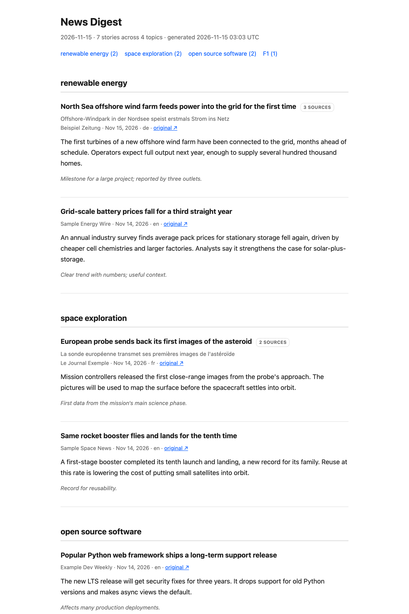

# Newsfold

[](https://github.com/2790karthikbhat/newsfold/actions/workflows/ci.yml)

**Follow any topic across languages and get one calm, translated, ranked digest — not
fifty tabs.** Pulls Google News RSS plus your own feeds, decodes and de-duplicates the
links, clusters the same story across outlets, has an LLM (Claude, OpenAI, Azure
OpenAI, or a local LM Studio / Ollama model) rank, translate and summarise the
survivors, and writes a single HTML/Markdown page. Runs fine with no LLM at all.



<sub>Sample data (`scripts/demo_digest.py`) — fictional outlets, no network or API key.</sub>

## Install

```bash
pipx install git+https://github.com/2790karthikbhat/newsfold
# or from a checkout:  pipx install .
```

Needs Python 3.13+. Installs the `digest` command.

## Quickstart

```bash
digest init                          # copies default config to ~/.config/newsfold/, creates the DB
digest topics sync                   # load topics.yaml (edit it first — the defaults are examples)
digest run && digest render --open   # fetch → … → render, then open the digest
```

No API key? `digest run` still writes a digest (original titles + excerpts) and says
the LLM stages were skipped. To enable them, put e.g. `ANTHROPIC_API_KEY=…` in
`~/.config/newsfold/.env` — see [LLM provider](#llm-provider). Every run prints its
token usage and cost; `digest run --dry-run` shows the planned LLM calls without
spending anything.

**Where things live.** Installed: config in `~/.config/newsfold/`, database and
rendered digests in `~/.local/share/newsfold/` (`XDG_CONFIG_HOME` /
`XDG_DATA_HOME` respected). In a source checkout: `config/`, `data/`, `out/` in the
repo. Override with `NEWSFOLD_HOME` (data + out + config) or
`NEWSFOLD_CONFIG_DIR`. Any config file you haven't copied falls back to the
packaged default in `src/newsfold/defaults/`.

### Set it up with an AI coding assistant

The repo is written to be set up by an agent (Claude Code, Codex, Cursor, Copilot,
Gemini CLI, …). Clone it, open your assistant in the folder, and say:

> Set up newsfold for me.

[`AGENTS.md`](AGENTS.md) gives it the playbook: which questions to ask you (topics,
languages, LLM provider, how to run it), the exact commands, and how to verify each
step. Nothing is installed or scheduled without asking you first.

## How it works

`digest run` chains these stages; each one is also its own command, safe to re-run.

| Stage                                                  | Command            | LLM? |
| ------------------------------------------------------ | ------------------ | ---- |
| Fetch Google News RSS + your own feeds                 | `digest fetch`     | no   |
| Decode Google News redirect links → real publisher URLs | `digest decode`    | no   |
| Cluster the same story across outlets and score it     | `digest cluster`   | no   |
| Rank each topic's clusters by newsworthiness           | `digest rank`      | yes  |
| Fetch full article text for the ranked survivors       | `digest extract`   | no   |
| Classify + translate + summarize each survivor         | `digest process`   | yes  |
| Render the digest file (HTML / Markdown)               | `digest render`    | no   |

Also: `digest sources …` (add a website or feed), `digest serve` (local web UI),
`digest sports fetch` (optional football/cricket/F1 widget data). Without a
configured LLM provider, `digest run` still produces a digest (original titles +
body excerpts) and notes that rank/process were skipped.

## LLM provider

The `rank` and `process` stages call a model. Pick a provider in
`config/settings.yaml` under `[llm]` and fill in its block:

| provider    | needs                        | notes                                                                                                                                                  |
| ----------- | ---------------------------- | ------------------------------------------------------------------------------------------------------------------------------------------------------ |
| `anthropic` | `ANTHROPIC_API_KEY`          | default; `model` for enrich, `rank_model` for ranking                                                                                                  |
| `openai`    | `OPENAI_API_KEY`             | OpenAI chat-completions                                                                                                                                |
| `azure`     | `AZURE_OPENAI_API_KEY` + `AZURE_OPENAI_ENDPOINT` | Azure OpenAI; `NEWSFOLD_LLM_MODEL` = deployment name. `api_version` defaults to GA `2024-10-21` (`/openai/deployments/{deployment}/…`); set `AZURE_OPENAI_API_VERSION=v1` for the versionless `/openai/v1/` API |
| `lmstudio`  | LM Studio running on `:1234` | no key; `model:` = the loaded model. JSON is prompt-only by default (MLX engines reject `response_format`); set `json_format: json_object` to force it |
| `ollama`    | `ollama serve` on `:11434`   | no key; set `model:` to a pulled model                                                                                                                 |

`openai` / `azure` / `lmstudio` / `ollama` share one code path (OpenAI-compatible API);
`anthropic` is a separate raw-HTTP wrapper. No SDKs — just `httpx`.

```bash
poetry run digest process --dry-run   # prints the planned calls, no network, no key
poetry run digest rank    --dry-run
```

**Switch provider/model without editing `settings.yaml`.** Every `[llm]` value is
`${VAR:-default}` — set the env var instead (in `.env` or the shell) and the
tracked file stays untouched:

```bash
export NEWSFOLD_LLM_PROVIDER=ollama     # anthropic | openai | azure | lmstudio | ollama
export NEWSFOLD_LLM_MODEL=llama3.1      # applies to whichever provider is active
poetry run digest process --dry-run
```

See `.env.example` for the full list (`_PROVIDER`, `_MODEL`, `_RANK_MODEL`,
`_BASE_URL`, `_JSON_FORMAT`). This works for any config value, not just `[llm]` —
`${VAR}` / `${VAR:-default}` is substituted anywhere in any `config/*.yaml` file.

## Development setup (source checkout)

```bash
poetry install
poetry run pre-commit install
cp .env.example .env          # LLM key — only needed for `rank` / `process`
poetry run digest init        # copies defaults into config/ (git-ignored), creates the DB
```

The SQLite DB lives at `data/newsfold.db` (git-ignored). Delete it for a clean
slate. After pulling a change that adds a migration, run `digest migrate` (commands
warn when the schema is behind).

## Configuration (`config/` — or `~/.config/newsfold/` when installed)

| File            | What it controls                                                                                                                                                                                |
| --------------- | ----------------------------------------------------------------------------------------------------------------------------------------------------------------------------------------------- |
| `topics.yaml`   | the persistent + temporary topics to follow (keyword, mode, languages)                                                                                                                          |
| `sources.yaml`  | example user feeds — seed the DB with `digest sources sync`; the DB is the source of truth at runtime                                                                                           |
| `tiers.yaml`    | small tier-1 publisher allowlist — a cluster containing one gets a score bonus                                                                                                                  |
| `pricing.yaml`  | USD per million input/output tokens per model, for the per-run cost summary (unknown model → "cost unknown"; local providers → $0) |
| `settings.yaml` | DB URL, target reading language, lookback window, decode/extract interval + concurrency, clustering thresholds, per-run caps, `[llm]` provider + models, `[retention]` auto-archive/delete days |

## Running the pipeline (stage by stage)

```bash
# 1. load topics from config into the DB
poetry run digest topics sync
poetry run digest topics list

# 2. (optional) register custom feeds
poetry run digest sources add "https://vnexpress.net/rss/the-thao.rss" --topic "sports Vietnam"
poetry run digest sources add "https://some-blog.com"        # homepage → feed autodiscovery
poetry run digest sources sync                                # or: seed all of config/sources.yaml
poetry run digest sources list

# 3. fetch raw articles (Google News RSS + active user feeds)
poetry run digest fetch

# 4. resolve Google News blob links to real publisher URLs
#    each request is still paced ~1s (Google 429s otherwise); config's
#    ingestion.decode_concurrency (default 3) runs that many in parallel
poetry run digest decode --limit 50
poetry run digest decode                                      # the rest
poetry run digest decode --concurrency 1                      # back to fully serial
poetry run digest decode --concurrency 6                      # push harder (watch for 429s)

# 5. cluster same-story articles and score them (no LLM)
poetry run digest cluster --show 10

# 6. LLM: rank the survivors per topic, keep the best
poetry run digest rank

# 7. fetch full article text for the ranked survivors (no LLM)
#    concurrent by default too (processing.extract_concurrency, default 5) — no
#    single shared endpoint here, so it parallelizes even better than decode
poetry run digest extract
poetry run digest extract --concurrency 1   # back to fully serial

# 8. LLM: classify + translate + summarize each survivor
poetry run digest process

# 9. render the digest → out/digest-YYYY-MM-DD.html
poetry run digest render                                      # --format md, --open
```

Or run every stage at once:

```bash
poetry run digest run                     # the full chain
poetry run digest run --decode-limit 30   # cap the slow decode step while testing
poetry run digest run --dry-run           # do everything except spend LLM tokens
```

```
run 12: fetched 161 new · decoded 40 (0 broken) · 92 clusters, 71 survivors ·
        ranked 34 · extracted 31 (3 headline-only) · enriched 30 (1 off-topic, 0 failed) ·
        wrote out/digest-2026-09-09.html
```

## Web UI

A minimal **local-only** web UI to browse digest history, read and save articles,
and manage topics/sources instead of using the CLI.

```bash
poetry run digest serve                 # http://127.0.0.1:8765
poetry run digest serve --port 9000     # different port
poetry run digest serve --reload        # auto-reload on code changes (dev only)
```

Binds to `127.0.0.1` only by default — it is not meant to be exposed on the network.

Each stage still runs in its own transaction, so a re-run resumes cleanly.

Each command is idempotent — re-running `fetch` / `decode` / `cluster` / `extract`
only processes new rows. An article whose text can't be fetched (paywall, bot-block,
JS-only page) is flagged `headline_only` and still flows downstream.

**Safe to interrupt.** `fetch`, `decode`, `extract`, `rank`, and `process` commit
each row/topic as they finish it, not once at the end — a flaky local model (timeouts,
connection drops) or a deliberate Ctrl+C only ever loses the one item in flight.
Press Ctrl+C and you'll see `interrupted — progress made so far is saved; re-run to
continue`; running the same command again only considers what's still unprocessed.

Long stages (`fetch`, `decode`, `extract`, `rank`, `process`, and `run`) show a live
progress bar in a terminal — `m/n` done, elapsed time, and the current item — and
fall back to a throttled plain line when output is piped or run from cron.

## Inspecting results in the CLI

```bash
# pipeline overview: article counts per stage + latest run
poetry run digest status
```

```
articles: 1325   clusters: 985
by stage:      fetched=222  decoded=704  clustered=211  processed=52  discarded=134  broken=2
by read state: unread=1325  saved=0
by source:     google_news=1086  user_source=239
latest run #14 started 2026-09-14T08:53:28 finished 2026-09-14T08:53:41
```

```bash
# the resolved publisher URLs after decoding
poetry run digest articles list --status decoded --urls

# full detail (id, stage, score, cluster, source, title, URL) — highest score first
poetry run digest articles list --topic "F1" --limit 20
poetry run digest articles list --status clustered         # cluster survivors, ready for extract
poetry run digest articles list --cluster <cluster_id>      # every article in one cluster
poetry run digest articles list --read-state unread         # what render would show today
poetry run digest articles list --saved                     # your read-later pile
```

After `digest extract`, check which bodies came through:

```bash
sqlite3 data/newsfold.db \
  "select count(*) filter (where body_original is not null) as bodies,
          count(*) filter (where headline_only) as headline_only
   from articles where status='clustered'"
```

`digest articles list` flags: `--status {fetched|decoded|clustered|processed|discarded|broken}`,
`--read-state {unread|read|archived}`, `--saved`, `--topic <keyword>`, `--cluster <id>`,
`--limit N`, `--urls` (compact id+status+URL).

`digest cluster` itself prints the per-topic ranked cluster list (`*` = survives the
top-N cap and goes to the ranking pass).

Raw SQLite is always available too:

```bash
sqlite3 data/newsfold.db "select status, count(*) from articles group by status"
```

## Managing articles

Reader state (`read_state`: `unread → read → archived`, plus an independent `saved`
flag) is separate from pipeline state — it only applies to articles that actually
reached you (`status in (clustered, processed)`). Archive is reversible; delete is
permanent.

```bash
poetry run digest articles read 1251 1318         # mark read — stops showing in the digest
poetry run digest articles unread 1251            # undo
poetry run digest articles archive 1251           # reversible "done with this"
poetry run digest articles unarchive 1251         # back to read
poetry run digest articles save 1251              # read-later — independent of read/archived,
poetry run digest articles unsave 1251            #   never touched by auto-archive/auto-delete
poetry run digest articles delete 1251 --yes      # permanent — asks to confirm without --yes
```

`digest render` / `digest run` only show `unread` articles by default — once you
read or archive something it stops reappearing. Pass `--include-read` to see
everything regardless of read_state:

```bash
poetry run digest render --include-read
poetry run digest run --include-read
```

**Retention housekeeping** (`digest cleanup`) is config-driven
(`config/settings.yaml` `[retention]`) and only ever runs when you invoke it —
never silently inside `digest run`. It never touches a `saved` article no matter
how old:

```bash
poetry run digest cleanup --dry-run     # see what would happen first
poetry run digest cleanup
poetry run digest cleanup --archive-days 7 --delete-days 60   # one-off override
```

```
[dry-run] would archive 71 stale unread article(s)
[dry-run] would delete 0 old discarded/broken article(s)
```

- **Auto-archive** (`retention.auto_archive_after_days`, default 14): stale
  **unread** `clustered`/`processed` articles → `archived`. Reversible.
- **Auto-delete** (`retention.auto_delete_after_days`, default 30): old
  **`discarded`/`broken`** rows only — pipeline noise you never saw — hard-deleted.
  Never touches anything `unread`/`read`/`archived`, regardless of age.

## Scheduling

There's no daemon; schedule `digest run` yourself. With cron (`crontab -e`):

```cron
0 7 * * *  cd /path/to/newsfold && /path/to/poetry run digest run >> data/cron.log 2>&1
```

`digest cleanup` is deliberately _not_ wired into `digest run` — add it as its own
cron line once you're comfortable with what it does (`--dry-run` it a few times first):

```cron
30 7 * * *  cd /path/to/newsfold && /path/to/poetry run digest cleanup >> data/cron.log 2>&1
```

## Development

```bash
poetry run pytest
poetry run ruff check .
poetry run black --check .
poetry run mypy
poetry run pre-commit run --all-files
```

Contributions are welcome. Before changing code, read [`AGENTS.md`](AGENTS.md)'s
pointers and [`CLAUDE.md`](CLAUDE.md): the layer rules and pipeline invariants
there (what each module may and may not do, what must stay idempotent) are what
reviews check against. CI runs the same pre-commit hooks and tests as above.

## Docker

Every push to `main` and every `v*` tag publishes a multi-arch (amd64 + arm64) image:

```bash
docker run --rm -p 8765:8765 --env-file .env \
  -v "$PWD/data:/app/data" -v "$PWD/out:/app/out" -v "$PWD/config:/app/config:ro" \
  ghcr.io/2790karthikbhat/newsfold:latest
```

The image runs `digest migrate` and then `digest serve`; any `config/*.yaml` you don't
mount falls back to the packaged defaults.

### Docker Compose (always-on server, optional Glance dashboard)

```bash
docker network create dashboard   # once; docker-compose.yml expects this network
cp .env.example .env              # fill in real keys
mkdir -p config && cp src/newsfold/defaults/*.yaml config/   # then edit config/topics.yaml
docker compose up -d --build
docker compose exec newsfold digest topics sync
docker compose exec newsfold digest run
```

Full guide, including scheduling with systemd timers and Glance widgets:
[`docs/deploy-server.md`](docs/deploy-server.md).
